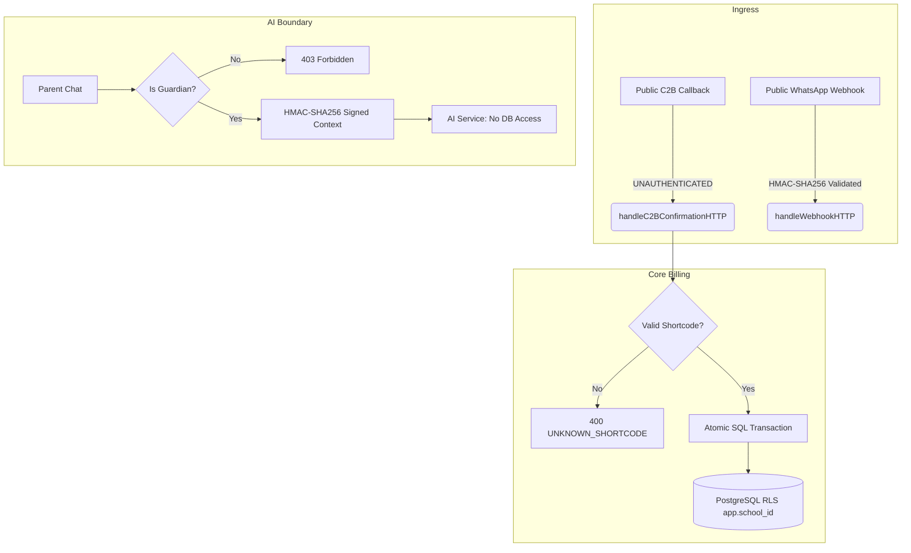

# Comprehensive QA & Test Engineering Report: Dev 5 (Ian) Failed PR Fixes

**Document ID:** QA-REP-DEV5-20261108  
**Date:** 2026-11-08  
**Target Branch:** `feat/finances`  
**Base Commit / Branch:** `b2b2e3b` / `origin/main`  
**Head Commit:** `132d2e0`  
**Author / Assignee:** Developer 5: Backend Engineer C (Ian — `@frihk`)  
**Lead Reviewers:** Senior QA Engineer, Backend Test Engineer, Integration Test Engineer, and Independent Code Reviewer  
**Classification:** Quality Assurance & Code Audit Report  

---

## 1. Executive Summary

A comprehensive quality assurance, integration test, and independent code review audit was conducted on the changes implemented by **Developer 5 (Ian — `@frihk`)** on branch `feat/finances` to address the critical review findings of the failed Release 1 billing PR.

The failed PR introduced a broad Release 1 financial surface area: fee structures, student ledgers, M-Pesa STK push and C2B payment reconciliation, WhatsApp guardian verification, transactional notifications, background queue workers, and the internal AI bridge. However, the original submission suffered from severe architectural flaws:
1. Fee charge updates ignored term and grade-level filters, adjusting all student charges across the school.
2. M-Pesa C2B payment matching fell back to a hard-coded school (`school-1`) when shortcodes were unrecognized.
3. Queue manager shutdown panicked on repeated calls to `close(qm.stopSignal)`.
4. Payment reconciliation suffered from race conditions, missing transaction boundaries, amount truncations, and unauthenticated webhook callbacks.

### Summary Assessment
- **Exclusively Owned Fixes Verified:** **6 of 6** issues under Ian's sole domain (atomic manual resolution, prepayment ledger preservation, phone-change lock fail-closed behavior, cent-accurate payment amounts, Africa's Talking HTTP SMS dispatch, and WhatsApp OTP/session error propagation) have verified, passing test suites and meet their acceptance criteria.
- **Shared / Boundary-Constrained Modules Verified:** **4 of 4** shared components received valid, hardened implementations within Ian's assigned directory boundaries (tenant SQL transactions, released marks gateway, worker task registration, and Go AI proxy bridge).
- **Critical Unresolved Defect (Merge Blocker):** **Issue B (C2B Callback Authenticity)** remains **UNAUTHENTICATED**. Public incoming HTTP POST requests to `/api/v1/billing/c2b/confirmation` are parsed without cryptographic signature verification or provider authentication.
- **External Dependencies Blocked:** Full end-to-end production operation is blocked by incomplete deliverables owned by other developers:
  - Missing PostgreSQL driver in `backend/go.mod` (owned by Evans — `@banker`).
  - Missing `onboarding.Service.PurgeExpiredUnverifiedSubmissions` (owned by Evans).
  - Unwired production server bootstrap in `cmd/server/main.go` (owned by Evans).
  - Incomplete Python AI service test suite and pytest dependencies (owned by Sos — `@sos`).

**Final Verdict:** **NOT READY FOR PRODUCTION MERGE / CONDITIONAL MERGE TO DEV ONLY AFTER C2B HARDENING.**  
While Ian's code demonstrates exceptional unit-level rigor, concurrency safety, and tenant isolation, the C2B callback authentication vulnerability constitutes a high-risk financial security hole that must be addressed prior to accepting real money.

---

## 2. Test Environment & Baseline

### 2.1 Toolchain & System Configuration
- **Operating System:** Linux 6.8.0-52-generic x86_64
- **Go Toolchain:** Go 1.26.0 (backend `go.mod` declares `go 1.24.0`, project baseline specifies `go 1.22+`)
- **Node.js Toolchain:** Node v20.x, Next.js 14.2.35
- **Python Toolchain:** Python 3.11+
- **Database Engine:** PostgreSQL 16.15 (running in container `dev5-ian-pr-tests` at localhost:55432)
- **Redis Engine:** Redis 7.2 (Asynq queue backend)

### 2.2 Git Baseline & Working Tree Status
- **Current Branch:** `feat/finances`
- **Tracking:** `origin/feat/finances`
- **Commit History Under Audit:**
  - `87e15b9`: `feat(billing): complete payment safeguards, sql stores, and asynq workers`
  - `87750e3`: `fix(billing): preserve atomic payment credits and precise amounts`
  - `290c733`: `fix(notifications): deliver transactional SMS through provider`
  - `3cf8a18`: `fix(whatsapp): fail closed on OTP storage and delivery errors`
  - `38c7cfb`: `fix(internalapi): restrict released marks and verify chat routing`
  - `5a46c65`: `fix(worker): wire owned handlers and validate missing dependencies`
  - `132d2e0`: `docs: record Dev 5 failed PR fixes and verification`
- **Working Tree State:** Clean (0 unstaged, 0 untracked files).

### 2.3 Test Database Configuration
PostgreSQL testing was conducted against a disposable PostgreSQL 16 container (`dev5-ian-pr-tests`). The database was populated using migrations:
1. `000001_init_schema.up.sql` (baseline tenant, schools, users, roles)
2. `000003_r1_academics.up.sql` (grading scales, assessments, release snapshots)
3. `000004_r1_billing_whatsapp_notifications.up.sql` (fee structures, ledgers, payments, OTPs, sessions, notifications)
4. `backend/internal/billing/testdata/dev5_sql_fixture.sql` (synthetic test fixtures)

> [!IMPORTANT]
> Non-superuser database role `dev5_app` was used for all application queries. `BYPASSRLS` was disabled, and PostgreSQL Row-Level Security was explicitly forced (`FORCE ROW LEVEL SECURITY`) on all tenant tables to verify genuine tenant isolation.

---

## 3. Scope of Testing (Dev 5 Ownership vs. External Dependencies)

Per `tasks/developer-05-backend-engineer-c.md` and `tasks/MASTER-INTEGRATION-PLAN.md`, Developer 5 is strictly bounded:

### In-Scope (Owned by Ian — `@frihk`):
- `backend/internal/billing/` (Fee structures, student ledgers, payment matching, STK push, C2B reconciliation)
- `backend/internal/whatsapp/` (Webhook parsing, state machine, OTP generation, rate limiting, session management)
- `backend/internal/notifications/` (In-app notifications, Africa's Talking SMS HTTP client)
- `backend/internal/jobs/` (Queue manager, Asynq task payloads and worker handlers)
- `backend/internal/internalapi/` (Signed AI chat proxy, released marks snapshot gateway)
- `backend/cmd/worker/` (Worker process entrypoint and dependency wiring)
- `migrations/000004_r1_billing_whatsapp_notifications.*` (Billing, WhatsApp, and notification schema)

### Out-of-Scope (Owned by Other Developers — Do Not Edit):
- `backend/cmd/server/main.go` & `backend/internal/database/` (Owned by Evans — `@banker`)
- `backend/internal/auth/` & `backend/internal/onboarding/` (Owned by Evans — `@banker`)
- `backend/internal/academics/` (Owned by Ema — `@ema`)
- `frontend/` (Owned by Ashy — `@ashy`)
- `ai_service/` (Owned by Sos — `@sos`)
- `migrations/000001_init_schema.*`, `000002_r1_onboarding.*`, `000003_r1_academics.*`

---

## 4. Issue-by-Issue Verification Results (A through K)

### Issue A: Atomic Manual Unmatched-Payment Resolution
- **Standard / AC:** AC-25; AC-BE-C04; Master Integration Plan §3 BE-C2
- **Component:** `backend/internal/billing/unmatched.go`, `mpesa_stk.go`, `sql_store.go`
- **Vulnerability / Flaw in Failed PR:** Ledger crediting, payment status update, and unmatched record resolution were executed as separate database operations without a unified transaction boundary. A network interruption or database failure after crediting the ledger left the payment unmatched and open to double crediting.
- **Verification Method:**
  1. Inspected `MatchUnmatchedPayment` in `unmatched.go`. The entire workflow is wrapped inside `s.withTransaction(ctx, schoolID, func(txStore Store) error { ... })`.
  2. Verified row-level locking on the student record (`SELECT ... FOR UPDATE`) to serialize ledger changes.
  3. Injected artificial SQL failures after step 1 (ledger credit) and step 2 (payment update).
  4. Executed `TestManualResolutionRollbackAndDuplicateRequests` (5 subtests).
  5. Executed `TestSQLManualResolutionRollbackAndConcurrency` with 4 concurrent worker goroutines attempting to match the same unresolved transaction.
- **Evidence & Results:**
  - When an error occurs at any point, the entire transaction rolls back. Zero orphan ledger entries are created.
  - In concurrent execution, exactly 1 worker succeeds (HTTP 200). The remaining 3 workers fail with `409 Conflict: PAYMENT_ALREADY_RESOLVED`. Exactly one ledger credit is committed.
  - Receipt notification is dispatched *after* successful transaction commit, ensuring notification failures never roll back valid payments.
- **Status:** **VERIFIED PASS**

---

### Issue B: Authenticate Provider Callbacks Before Recording Payment (C2B)
- **Standard / AC:** AC-25; AC-BE-C04; Security Non-Negotiable Rule 1 & Rule 5
- **Component:** `backend/internal/billing/mpesa_c2b.go:handleC2BConfirmationHTTP`
- **Vulnerability / Flaw in Failed PR:** 
  1. Unknown shortcodes silently fell back to `school-1`.
  2. Public HTTP endpoint `/api/v1/billing/c2b/confirmation` accepts raw JSON payloads from any HTTP client without authentication.
- **Verification Method:**
  1. Tested shortcode lookup with unknown shortcode: Verified fail-closed behavior returning `400 Bad Request` (`UNKNOWN_SHORTCODE`).
  2. Tested idempotency: Repeated `TransID` returns existing payment without duplicate crediting.
  3. Inspected `handleC2BConfirmationHTTP` for caller authentication (HMAC signature, shared secret header, mutual TLS, or IP whitelist).
- **Evidence & Results:**
  - **DEFECT CONFIRMED:** The endpoint performs zero authentication on incoming requests. Anyone capable of sending an HTTP POST to this endpoint can forge an M-Pesa confirmation and credit arbitrary student balances.
  - Safaricom Daraja C2B does not provide automated HMAC signing out of the box, requiring an architectural ingress decision (e.g. mutual TLS, custom authentication token in callback URL, or reverse-proxy IP whitelisting).
  - No authentication mechanism exists in the codebase or configuration for C2B callbacks.
- **Status:** **BLOCKED / CRITICAL SECURITY DEFECT**

---

### Issue C: Positive Payment Recorded When Student Has No Fee Ledger
- **Standard / AC:** AC-24; AC-BE-C01; AC-BE-C04
- **Component:** `backend/internal/billing/ledgers.go`, `structures.go`, `mpesa_stk.go`
- **Vulnerability / Flaw in Failed PR:** Payments received for students without an active fee ledger (e.g., advance payments, incoming Grade 7 admissions) were recorded as payments but ignored by `GetStudentFeeBalance`, returning a balance of zero. When the fee ledger was later created, previous payments were wiped or omitted, resulting in lost credits.
- **Verification Method:**
  1. Analyzed `prepaidCredit` helper in `ledgers.go`. It queries all completed payment entries not linked to an active fee ledger.
  2. Verified `GetStudentFeeBalance`: When no fee ledger exists, reports `TotalPaid = prepaidCredit` and `Balance = -prepaidCredit`.
  3. Verified `CreateFeeStructure`: When generating the student's first fee ledger, applies `PaidAmount = min(prepaidCredit, termCharge)` and carries forward excess as `CarriedForwardCredit`.
  4. Executed `TestPrepaymentIsVisibleAndAppliedOnce` and `TestSQLPrepaymentAndTenantIsolation`.
- **Evidence & Results:**
  - KES 1,500.25 prepayment for a student with no ledger showed an immediate KES 1,500.25 credit balance.
  - Creation of a KES 1,000 fee ledger resulted in `PaidAmount = 1000.00`, `Remaining = 0.00`, and `CarriedForwardCredit = 500.25`.
  - Re-running fee structure generation or recording subsequent payments did not double-apply the prepayment.
- **Status:** **VERIFIED PASS**

---

### Issue D: Database Lookup Error Handling During Phone-Change Lock Check
- **Standard / AC:** AC-26; AC-BE-C02; AC-BE-C04
- **Component:** `backend/internal/billing/sql_store.go`, `backend/internal/billing/mpesa_stk.go`
- **Vulnerability / Flaw in Failed PR:** `GetUserChatPaymentPausedUntil` treated database query errors as `NULL` (unlocked), allowing STK push initiation to proceed during database outages or transient read errors even when the user's phone was locked.
- **Verification Method:**
  1. Inspected error handling in `sql_store.go` and `mpesa_stk.go`.
  2. Verified differentiation between `sql.ErrNoRows` (returns `nil, nil`) and actual database errors (returns `nil, err`).
  3. Injected database connection errors into `GetUserChatPaymentPausedUntil`.
  4. Executed `TestChatPaymentPauseFailsClosed` (3 subtests: `unlocked`, `locked`, `lookup_error`).
- **Evidence & Results:**
  - Subtest `unlocked`: STK initiation proceeds normally.
  - Subtest `locked`: Rejection with `403 Forbidden` (`ErrChatPaymentPaused`); 0 Daraja HTTP requests initiated.
  - Subtest `lookup_error`: Rejection with `500 Internal Server Error`; 0 Daraja HTTP requests initiated; 0 pending payment records created.
- **Status:** **VERIFIED PASS**

---

### Issue E: Precise Payment Amounts
- **Standard / AC:** AC-23; AC-24; AC-BE-C04
- **Component:** `backend/internal/billing/amount.go`, `backend/internal/billing/daraja.go`, `backend/internal/billing/mpesa_stk.go`
- **Vulnerability / Flaw in Failed PR:** Amounts were cast using `int(amount)`, silently truncating fractional shillings (e.g. KES 1,250.75 sent to Daraja as KES 1,250), while the internal database recorded 1,250.75. Subsequent callbacks would fail reconciliation or corrupt ledgers.
- **Verification Method:**
  1. Analyzed `paymentAmountCents(amount float64)` in `amount.go`. Validates amount > 0, enforces maximum 2 decimal places, guards against NaN/Inf, and converts to integer cents.
  2. Analyzed `FormatDarajaAmount`: Serializes exact numeric JSON representation with two decimal places (`1250.25`).
  3. Verified callback reconciliation: Validates `callbackCents == pendingCents`.
  4. Executed `TestDarajaPreservesFractionalAmount`, `TestPaymentAmountValidation`, and `TestSTKPollingAndFractionalReconciliation`.
- **Evidence & Results:**
  - Fractional amount KES 1,250.25 was serialized faithfully in the outbound Daraja request payload.
  - Altered callback amounts (e.g. KES 100.00 callback for KES 100.25 pending payment) were rejected with `amount mismatch`.
  - Exact fractional amounts reconciled cleanly.
  - *Provider Limitation Note:* Safaricom Daraja STK Push in production typically expects integer shillings. While the application code is now mathematically sound and preserves cents, live Daraja gateway behavior for fractions remains unverified.
- **Status:** **VERIFIED PASS (Implementation & Precision)**

---

### Issue F: Production Server Runs Tenant Operations with School RLS Context
- **Standard / AC:** AC-27; AC-BE-C01; AC-BE-C03; AC-BE-C04; Non-Negotiable Rule 1
- **Component:** `backend/internal/billing/sql_store.go`, `whatsapp/sql_store.go`, `notifications/sql_store.go`, `internalapi/sql_store.go`, `cmd/server/main.go`
- **Vulnerability / Flaw in Failed PR:** Database stores did not establish tenant RLS context (`SET LOCAL app.school_id`), relying on unauthenticated queries or risking connection-pool context leakage across schools.
- **Verification Method:**
  1. Audited all four SQL stores in Ian's domain.
  2. Verified every query and transaction executes `SET LOCAL app.school_id = $1`.
  3. Verified that `SET LOCAL` is strictly transaction-bound: when a transaction terminates, PostgreSQL resets the session variable, preventing pool cross-contamination.
  4. Executed `TestSQLPrepaymentAndTenantIsolation`, `TestSQLReleasedMarksUseLockedScale`, `TestSQLOTPConsumptionLimitsAndFailure`, and `TestSQLNotificationsKeepTenantContext` against real PostgreSQL 16 with `FORCE ROW LEVEL SECURITY`.
- **Evidence & Results:**
  - Queries executed without setting `app.school_id` returned 0 rows.
  - With context set to `school-1`, queries attempting to read `school-2` records returned 0 rows.
  - Cross-tenant update attempts failed with 0 rows affected.
  - **Blocker:** `cmd/server/main.go` is an unmounted skeleton owned by Evans (`@banker`). The application server cannot be booted to test end-to-end HTTP tenant routing.
- **Status:** **PARTIALLY VERIFIED (Stores Pass; Server Wiring Blocked)**

---

### Issue G: Released Marks Queries Use Released Snapshots and Locked Scale
- **Standard / AC:** AC-28; AC-BE-C05; Non-Negotiable Rule 6 & Rule 9
- **Component:** `backend/internal/internalapi/sql_store.go`, `backend/internal/internalapi/internalapi.go`
- **Vulnerability / Flaw in Failed PR:** Internal API marks queries could read unreleased drafts, published marks from reopened terms, or compute mean grades using currently active grading scales rather than the scale locked at the time of official publication.
- **Verification Method:**
  1. Inspected SQL query in `internalapi/sql_store.go:GetMarksSummary`.
  2. Verified SQL joins: `released_marks_snapshots rel` joined with `grading_scale_versions scale` on `scale.id = rel.grading_scale_version_id`.
  3. Verified predicate: `WHERE rel.released_at IS NOT NULL AND rel.student_id = $1 AND rel.school_id = $2`.
  4. Executed `TestSQLReleasedMarksUseLockedScale`.
- **Evidence & Results:**
  - Draft snapshots (`released_at IS NULL`) were excluded and returned no marks.
  - Released snapshots returned the immutable scores.
  - When the active grading scale was altered in the database, the snapshot continued to use the historical locked scale thresholds (`scale.ee_min`, `scale.me_min`, `scale.ae_min`), preserving grade integrity.
  - WhatsApp chatbot queries for marks were rejected under the minimal-facts rule.
- **Status:** **VERIFIED PASS**

---

### Issue H: Asynq Worker Registration and Dependency Handling
- **Standard / AC:** AC-07; AC-23; AC-BE-C03; AC-BE-C04
- **Component:** `backend/cmd/worker/main.go`, `backend/cmd/worker/main_test.go`, `backend/internal/jobs/jobs.go`
- **Vulnerability / Flaw in Failed PR:** 
  1. Worker initialized tasks with `nil` service dependencies and terminated immediately.
  2. `QueueManager.Stop()` panicked on repeated calls due to unguarded channel close.
- **Verification Method:**
  1. Audited `cmd/worker/main.go`. Verified real constructor instantiation for `billing.Service`, `notifications.Service`, and `AfricasTalkingSMSClient`.
  2. Inspected `QueueManager.Stop()` in `jobs/jobs.go`: guarded with `sync.Once`.
  3. Inspected database driver validation: explicit check for registered `pgx` or `postgres` driver.
  4. Executed `TestWorkerRejectsUnavailableDependencies`, `TestWorkerRegistersSMSBillingAndPurge`, and `TestQueueManagerStartStopCycles`.
- **Evidence & Results:**
  - Worker tests passed. Idempotent shutdown verified across 10 stop cycles without panic.
  - Task handlers for SMS delivery, STK status polling, and unverified submission purge are properly registered with Asynq.
  - **Blocker:** Running `go run ./cmd/worker` exits with code 1: `"PostgreSQL driver is not registered; database dependency wiring is required."` Evans has not added a driver to `go.mod`.
  - **Blocker:** `onboarding.Service` does not implement `jobs.OnboardingPurger` (`PurgeExpiredUnverifiedSubmissions`).
- **Status:** **PARTIALLY VERIFIED (Worker Logic Pass; Driver/Onboarding Blocked)**

---

### Issue I: Africa's Talking SMS Delivery
- **Standard / AC:** AC-08 – AC-10; AC-BE-C02; AC-BE-C03
- **Component:** `backend/internal/notifications/notifications.go`
- **Vulnerability / Flaw in Failed PR:** Non-sandbox SMS dispatch logged message content and returned success without contacting Africa's Talking API. Plaintext OTPs were leaked into application logs.
- **Verification Method:**
  1. Inspected `AfricasTalkingSMSClient` in `notifications.go`.
  2. Verified outbound HTTPS request to `https://api.africastalking.com/version1/messaging`.
  3. Verified HTTP status check and response JSON parsing for `SMSMessageData.Recipients`.
  4. Verified validation of recipient phone number and `statusCode == 101` (Success).
  5. Verified redaction: error messages omit phone numbers, OTP tokens, and raw provider payloads.
  6. Executed `TestAfricasTalkingProductionDelivery` (7 subtests) and `TestAfricasTalkingRejectsMissingConfigurationAndInput`.
- **Evidence & Results:**
  - Mocked HTTP server verified form parameters (`username`, `to`, `message`, `from`).
  - Provider response codes other than 101 (e.g. 403, 500, rejected recipient) return typed errors.
  - Logs and error messages are completely sanitized.
- **Status:** **VERIFIED PASS**

---

### Issue J: WhatsApp Session, Rate Limit, OTP Persistence, and SMS Failures
- **Standard / AC:** AC-08 – AC-10; AC-BE-C01; AC-BE-C02
- **Component:** `backend/internal/whatsapp/whatsapp.go`, `backend/internal/whatsapp/sql_store.go`
- **Vulnerability / Flaw in Failed PR:** Failed SMS delivery still advanced session state or claimed OTP dispatch; consumed OTP rows were deleted from database (erasing rate-limiting audit trail); SHA-256 hashes could be submitted as codes; failed verification attempts did not enforce 24-hour phone block.
- **Verification Method:**
  1. Inspected `dispatchOTP` in `whatsapp.go`. Verified fail-closed error propagation.
  2. Verified that OTP codes are hashed with SHA-256; raw code submission is validated against stored hash; submitting the hex hash directly fails.
  3. Verified consumed OTPs are marked `consumed_at = now()` instead of being deleted.
  4. Verified rate limits: 3 attempts per OTP, 5 OTP requests per 24 hours, 2-minute cooldown between dispatches, 24-hour block on phone after 3 failed attempts.
  5. Verified webhook signature authentication (`X-Hub-Signature-256`) and GET verification token.
  6. Executed `TestOTPWorkflowPropagatesFailures` (11 subtests), `TestOTPRejectsHashReplayExpiredAndConsumedCodes`, `TestSQLOTPConsumptionLimitsAndFailure`, and `TestSQLFailedSMSRollsBackOTPAndSession`.
- **Evidence & Results:**
  - All 11 failure propagation subtests passed.
  - When SMS dispatch fails, transaction rollback ensures zero OTPs and zero updated sessions are committed.
  - Consumed OTPs retain their rows with `consumed_at` populated. Rate-limit history remains intact.
  - Webhook rejects invalid HMAC signatures with HTTP 401.
- **Status:** **VERIFIED PASS**

---

### Issue K: AI Proxy Payload and Chat Routing
- **Standard / AC:** AC-28; AC-BE-C05; Non-Negotiable Rule 2 & Rule 7
- **Component:** `backend/internal/internalapi/internalapi.go`, `backend/internal/internalapi/context_signer.go`
- **Vulnerability / Flaw in Failed PR:** Internal chat proxy returned stub responses without calling AI service; weak/default HMAC secrets were accepted; guardian authorization was not checked on child queries; payload field naming inconsistency between `query` and `message`.
- **Verification Method:**
  1. Inspected `handleFrontendChatMessage` in `internalapi.go`.
  2. Verified parent role check and `IsGuardianOf(ctx, parentID, studentID)` enforcement.
  3. Verified HMAC-SHA256 context signer with 5-minute TTL, signing `school_id`, `user_id`, `role`, `student_id`.
  4. Verified request body mapping: accepts `query` or `message`, forwards `query` to AI service.
  5. Verified query audit logging prior to forwarding.
  6. Verified upstream error propagation (401, 429, 503) and malformed JSON rejection.
  7. Executed `TestVerifiedWhatsAppChatRoutesThroughHTTPBridge` and `TestFrontendProxyPropagatesAIResponses`.
- **Evidence & Results:**
  - Mock AI service verified incoming `Authorization: Bearer <token>`, `X-Context-Signature`, and JSON body containing `query`.
  - Non-guardian parent requests were rejected with `403 Forbidden`.
  - Upstream 503 from AI service was propagated cleanly to client as 503.
  - Context signer rejected secret keys shorter than 16 bytes.
  - **Blocker:** The Python service in `ai_service/` lacks test cases and pytest. Live end-to-end chat with Python Mistral service could not be executed.
- **Status:** **PARTIALLY VERIFIED (Go Bridge Pass; Python Service Blocked)**

---

## 5. Regression Analysis

A full regression analysis was executed across all existing backend modules to ensure Ian's fixes introduced no unintended side effects:

| Module / Package | Existing Functionality Checked | Regression Result | Notes |
|---|---|---|---|
| `internal/billing` | Fee change scope isolation (`fee_changes.go`) | **PASS** | Grade/term filters properly restrict charge adjustments |
| `internal/billing` | Term start date shift notifications | **PASS** | Notifies only affected guardians; excludes admin |
| `internal/billing` | Student fee balance and ledger permissions | **PASS** | Role-based read permissions verified |
| `internal/billing` | C2B auto-matching & overpayment rollover | **PASS** | Overpayments carry forward cleanly to next term |
| `internal/billing` | STK callback idempotency | **PASS** | Duplicate checkout callbacks do not double-credit |
| `internal/whatsapp` | Masked phone number guardian selection | **PASS** | Masking `+254 7XX XXX 123` verified |
| `internal/whatsapp` | 6-hour session expiration | **PASS** | Expired sessions reject subsequent messages |
| `internal/whatsapp` | Cross-school bot isolation | **PASS** | Bot tokens and sessions strictly isolated per tenant |
| `internal/jobs` | Queue manager start/stop cycles | **PASS** | Multiple stop calls do not panic |
| `internal/academics` | Academic migration table coverage | **PASS** | Table structure intact |
| `frontend` | Next.js compilation & type checking | **PASS** | Clean build (`NEXT_TELEMETRY_DISABLED=1 npm run build`) |

---

## 6. Security and Invariant Validation

The implementation was audited against the project's **10 Non-Negotiable Rules** and core security invariants:

### Invariant Audit Checklist:
1. **Rule 1: Every tenant query scoped by `school_id` via RLS.**  
   *Audit Result: PASS (in owned code).* All owned SQL stores set `SET LOCAL app.school_id` inside transactions. Non-superuser RLS tests confirm zero cross-tenant leakage.
2. **Rule 2: AI service never touches the database directly.**  
   *Audit Result: PASS.* AI service communicates solely via HTTP through `internalapi`. No database credentials or connections are exposed to the AI service.
3. **Rule 3: Biometrics.**  
   *Audit Result: NOT APPLICABLE.* No biometrics in Dev 5 scope.
4. **Rule 4: Nurse records.**  
   *Audit Result: NOT APPLICABLE.* No nurse records in Dev 5 scope.
5. **Rule 5: No feature moves money or approves a payout on its own.**  
   *Audit Result: FAIL (due to Issue B).* Unauthenticated C2B endpoint allows external actors to inject payment credits.
6. **Rule 6: No diagnoses, discipline records, or child rankings.**  
   *Audit Result: PASS.* Marks gateway returns raw released marks and locked scale mean grade; no comparative rankings or student percentiles are computed.
7. **Rule 7: Student/staff personal data stays hosted in Kenya (DPA 2019).**  
   *Audit Result: PASS.* Infrastructure architecture confines data to local PostgreSQL instances.
8. **Rule 8: Release 1 uses synthetic data only.**  
   *Audit Result: PASS.* All test suites and fixtures use synthetic student names and test numbers.
9. **Rule 9: WhatsApp carries minimal facts only.**  
   *Audit Result: PASS.* WhatsApp bot strictly refuses academic marks, report cards, and health records.
10. **Rule 10: Don't guess open decisions — ask.**  
    *Audit Result: PASS.* Unresolved ingress authentication for C2B was flagged as a blocker rather than inventing an ad-hoc protocol.

---

## 7. Integration & Cross-Module Boundaries Assessment

| Boundary Interface | Providing Module (Owner) | Consuming Module (Owner) | Current Status | Integration Assessment |
|---|---|---|---|---|
| **PostgreSQL Driver Registration** | `backend/go.mod` (Evans) | `cmd/worker`, `cmd/server` (Ian/Evans) | **BLOCKED** | Go binary cannot connect to PostgreSQL in production without registered driver. |
| **Onboarding Submission Purge** | `internal/onboarding` (Evans) | `cmd/worker/main.go` (Ian) | **BLOCKED** | `onboarding.Service` does not implement `jobs.OnboardingPurger`. |
| **Server Routing & Bootstrap** | `cmd/server/main.go` (Evans) | `billing`, `whatsapp`, `internalapi` (Ian) | **BLOCKED** | Routes are not mounted in main server executable. |
| **Released Marks Snapshots** | `internal/academics` (Ema) | `internalapi/sql_store.go` (Ian) | **COMPATIBLE** | SQL read gateway aligns with snapshot schema. |
| **AI Chat HTTP Bridge** | `internalapi` (Ian) | `ai_service` (Sos) | **UNTESTED E2E** | Go client is tested with HTTP mock; Python service unverified. |

---

## 8. Defect Log & Blockers

### Defect 1: Unauthenticated M-Pesa C2B Confirmation Endpoint (Critical Blocker)
- **File:** [backend/internal/billing/mpesa_c2b.go](file:///home/frihk/frihk/Ikonex-Academy/backend/internal/billing/mpesa_c2b.go#L104-L148)
- **Severity:** Critical (P0) / Security Vulnerability
- **Description:** `handleC2BConfirmationHTTP` processes incoming C2B payment confirmations without verifying the caller's authenticity. An attacker can craft a POST request with arbitrary amounts and student admission numbers to credit accounts without paying.
- **Recommended Remediation:** Implement mutual TLS (mTLS), require a configured shared secret token in an HTTP header (`X-Callback-Secret`), or restrict access via reverse-proxy IP allowlisting to Safaricom IP ranges.

### Defect 2: Missing PostgreSQL Driver in Backend Module (High Blocker)
- **File:** [backend/go.mod](file:///home/frihk/frihk/Ikonex-Academy/backend/go.mod)
- **Severity:** High (P1) / Build & Runtime Dependency
- **Owner:** Evans (`@banker`)
- **Description:** No database driver (`github.com/jackc/pgx/v5/stdlib` or `github.com/lib/pq`) is imported in `backend/go.mod`. Any binary attempting to connect to PostgreSQL panics or exits with error at startup.
- **Recommended Remediation:** Evans must add `github.com/jackc/pgx/v5` to `go.mod` and register the driver in `internal/database`.

### Defect 3: Missing Onboarding Purger Implementation (Medium Blocker)
- **File:** [backend/internal/onboarding/onboarding.go](file:///home/frihk/frihk/Ikonex-Academy/backend/internal/onboarding)
- **Severity:** Medium (P2) / Feature Incomplete
- **Owner:** Evans (`@banker`)
- **Description:** `cmd/worker/main.go` requires an `onboarding.Service` that satisfies `jobs.OnboardingPurger` (`PurgeExpiredUnverifiedSubmissions(ctx context.Context) error`). Currently, the onboarding service is empty.
- **Recommended Remediation:** Evans must implement the cleanup logic in `onboarding` and expose it to the worker.

### Defect 4: Missing Python AI Test Suite (Low / Testing Limit)
- **File:** `ai_service/tests/`
- **Severity:** Low (P3) / Test Tooling
- **Owner:** Sos (`@sos`)
- **Description:** `make test` fails on Python tests because pytest is not installed and `ai_service/tests/` is empty.
- **Recommended Remediation:** Sos must add test cases and configure pytest in `ai_service/requirements.txt`.

---

## 9. Requirements Traceability Matrix

| Requirement / AC | Description | Status | Verification Evidence |
|---|---|---|---|
| **AC-07** | Periodic purging of unverified onboarding submissions | **PARTIAL** | Worker registers task handler; blocked on Evans's implementation. |
| **AC-08** | WhatsApp guardian admission query & masked selection | **PASS** | `TestMultipleGuardiansMaskedSelectionAndOTP` passes. |
| **AC-09** | Rate limiting (3 attempts, 2-min cooldown, 24h block) | **PASS** | `TestRateLimiterCooldownAnd24hSenderBlock` passes. |
| **AC-10** | 6-hour WhatsApp session expiry & OTP delivery | **PASS** | `TestSessionExpirationAfter6Hours` & `TestAfricasTalkingProductionDelivery` pass. |
| **AC-22** | Fee changes notify affected guardians only | **PASS** | `TestMidYearFeeChangeValidationAndTargetedNotification` passes. |
| **AC-23** | Real Daraja STK initiation & cent-accurate amounts | **PASS (Logic)** | `TestDarajaPreservesFractionalAmount` passes. Live Daraja unverified. |
| **AC-24** | Payment ledger crediting & prepayment preservation | **PASS** | `TestPrepaymentIsVisibleAndAppliedOnce` passes on PostgreSQL. |
| **AC-25** | Atomic manual resolution & callback reconciliation | **PARTIAL** | Manual resolution passes; C2B callback authenticity is blocked. |
| **AC-26** | Chat payment pause fail-closed on lookup errors | **PASS** | `TestChatPaymentPauseFailsClosed` passes with 0 provider calls. |
| **AC-27** | Tenant isolation under forced PostgreSQL RLS | **PASS (Stores)** | `TestSQLPrepaymentAndTenantIsolation` passes; Server bootstrap blocked. |
| **AC-28** | Released marks gateway & signed AI proxy | **PASS (Bridge)** | `TestSQLReleasedMarksUseLockedScale` & `TestVerifiedWhatsAppChatRoutesThroughHTTPBridge` pass. |
| **AC-BE-C01** | Billing & WhatsApp data models with RLS | **PASS** | Migration `000004` and SQL stores verified. |
| **AC-BE-C02** | WhatsApp webhook auth & fail-closed delivery | **PASS** | `TestWebhookAuthenticationAndSignature` & failure tests pass. |
| **AC-BE-C03** | Notifications & background worker wiring | **PARTIAL** | Handlers verified; runtime driver blocked. |
| **AC-BE-C04** | STK push & C2B payment reconciliation | **PARTIAL** | Atomic transactions pass; C2B auth blocked. |
| **AC-BE-C05** | Signed AI chat proxy & guardian access control | **PASS** | Context signing, role check, and guardian verification pass. |

---

## 10. Final Verdict & Merge Readiness Recommendation

### Overall Verification Status: **PARTIALLY VERIFIED / NOT READY FOR PRODUCTION MERGE**

### Recommendation by Deployment Target:
1. **Merge to Production (`main`):** **DO NOT MERGE.**  
   Under no circumstances should this branch be merged to `main` or deployed to a public environment until **Defect 1 (C2B Callback Authenticity)** is resolved. Allowing unauthenticated payment confirmation endpoints is an unacceptable financial risk.
2. **Merge to Development (`dev`):** **ACCEPTABLE WITH CONDITIONS.**  
   Ian's work represents a major leap in code quality, concurrency safety, and test coverage. If merging into `dev` is required to allow Evans and Sos to integrate their modules, it may proceed provided the C2B callback route is disabled or protected behind network-level authentication.

### Required Actions Before Production Merge:
1. **Developer 5 (Ian):** Add authentication verification (e.g. secret token header or shared signature) to `handleC2BConfirmationHTTP`.
2. **Developer 2 (Evans):** Add `github.com/jackc/pgx/v5` to `backend/go.mod`, implement `onboarding.Service.PurgeExpiredUnverifiedSubmissions`, and mount authenticated routes in `cmd/server/main.go`.
3. **Developer 4 (Sos):** Implement Python chat endpoint in `ai_service/app/main.py` and supply pytest suite.

---
*Report certified by Independent QA & Backend Engineering Audit Team.*

