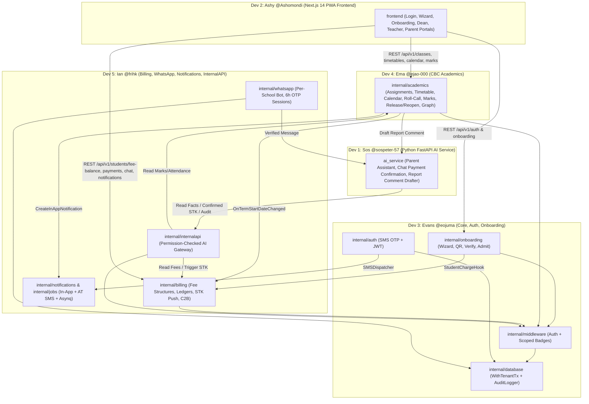

# Ikonex Academy – Release 1 Master Integration Plan

- **Document Version:** 1.0 (Release 1 Official Architecture & Execution Plan)
- **Authoritative Sources:** `Docs/Ikonex.md`, `Docs/REQUIREMENTS.md`, `Docs/ARCHITECTURE.md`, `Docs/API_CONTRACTS.md`, `Docs/DECISIONS.md`, `Docs/SECURITY.md`, `Docs/AGENTS.md`
- **Release 1 Scope:** Synthetic-data proof of concept (`C51, C52`), English only (`C56`), running against Safaricom Daraja sandbox and test WhatsApp numbers (`A17`). Passes when **Onboarding works**, **Parents can log in (App SMS OTP & WhatsApp 6h OTP session)**, **Badges work stress-free**, and **all Release 1 features work cleanly end-to-end (`C53, C54`)**.

---

## 1. Overview of the Five Developer Assignments

| Developer ID | Name | GitHub Tag | Role | Assigned Scope Summary | Task Document |
|---|---|---|---|---|---|
| **Developer 1** | **Sos** | `@sospeter-57` | AI Engineer (Python / FastAPI / Mistral) | Owns `ai_service/**`: Service-token + HMAC `X-User-Context` verifier, Parent Assistant (In-App & WhatsApp minimal-fact Q&A), Multi-turn M-Pesa Chat Payment Confirmation flow, CBC Report Card Comment & Re-Release Note Drafter, and AI Audit Logging. Zero direct DB access. | `tasks/developer-01-ai-engineer.md` |
| **Developer 2** | **Ashy** | `@Ashomondi` | Frontend Engineer (Next.js 14 / TypeScript / Tailwind PWA) | Owns `frontend/**`: Tailwind Design System, SMS OTP Login & Membership Switcher, Principal 5-Step Setup Wizard, Staff & 12h Parent QR Registration + In-Person Verification UI, Dean of Studies Workspace, Teacher Portal (Roll-Call, Marks, Hard-Gated Release/Reopen, AI Comment Drafter), and Parent Portal (Results, CBC Graph, Fee Ledger, STK Push, In-App AI Chat, 2FA Phone Change, R2 Placeholders). | `tasks/developer-02-frontend-engineer.md` |
| **Developer 3** | **Evans** | `@eojuma` | Backend Engineer A (Go — Core, Auth & Onboarding) | Owns `cmd/server`, `internal/config`, `internal/database`, `internal/middleware`, `internal/auth`, `internal/onboarding`, `internal/consent`, and `migrations/000001`–`000002`: PostgreSQL RLS (`WithTenantTx`), SMS OTP Login, Scoped/Time-Bound Badge Engine, Audit Logger, School Provisioning, Setup Wizard, Staff/Parent QR Codes, In-Person Verification & Document Deletion, Verifier Delegation, Student Admission, and Guardian 2FA Phone Change. | `tasks/developer-03-backend-engineer-a.md` |
| **Developer 4** | **Ema** | `@ejao-000` | Backend Engineer B (Go — CBC Academics & Results) | Owns `internal/academics` and `migrations/000003`: Dean of Studies Teacher Assignments, Timetables, School Calendar & Term-Date Fee Sync, Versioned CBC Grading Scales, Daily Class-Teacher Roll-Call Attendance, Anonymised Class Means, Subject Marks Entry & Reassignment, Hard-Gated Results Release/Reopen/Re-Release Snapshot State Machine, AI Drafter Proxy, and Student CBC Performance Graph. | `tasks/developer-04-backend-engineer-b.md` |
| **Developer 5** | **Ian** | `@frihk` | Backend Engineer C (Go — Billing, WhatsApp, Jobs & Internal AI API) | Owns `cmd/worker`, `internal/billing`, `internal/whatsapp`, `internal/notifications`, `internal/jobs`, `internal/internalapi`, and `migrations/000004`: Team-Loaded Fee Structures, Automated Term Charging, Ledger Credit Balances, Mid-Year Fee Changes, Daraja STK Push & Direct C2B Paybill Auto-Matching, Per-School WhatsApp Bot & 6h OTP Sessions, In-App + Transactional SMS Notifications, Asynq Workers, and Internal AI API. | `tasks/developer-05-backend-engineer-c.md` |

---

## 2. Complete Release 1 Feature Ownership Matrix

Every Release 1 feature and acceptance criterion (`AC-01` to `AC-29` in `Docs/Ikonex.md` Section 14) has a single accountable backend/AI owner and frontend integration owner:

| Area | Feature / Requirement | Acceptance Criteria (`Docs/Ikonex.md`) | Primary Backend / AI Owner | Frontend Owner |
|---|---|---|---|---|
| **Foundation** | Multi-school PostgreSQL RLS isolation (`SET LOCAL app.school_id`) | `AC-27` | **Evans** (`@eojuma` — `internal/database`) | — |
| **Foundation** | Roles & scoped/time-bound Badges engine (`class_teacher`, `delegated_verifier`) | `C53`, `AC-05`, `AC-14` | **Evans** (`@eojuma` — `internal/middleware`) | **Ashy** (`@Ashomondi` — `auth-context.tsx`) |
| **Foundation** | Centralized Audit Trail of all sensitive actions | `AC-29` | **Evans** (`@eojuma` — `internal/database/audit.go`) | — |
| **Foundation** | Phone + SMS OTP App Login & Membership Switcher | `AC-01` | **Evans** (`@eojuma` — `internal/auth`) | **Ashy** (`@Ashomondi` — `/login`) |
| **Foundation** | Consent Centre Schema (`biometric_attendance`, `photo`, `sms`, `whatsapp`) | Section 6.10 | **Evans** (`@eojuma` — `internal/consent`) | **Ashy** (`@Ashomondi` — `/parent/settings`) |
| **Onboarding** | Ikonex Team School + Principal creation & Required School Contact Profile | `AC-01`, `C37`, `C57` | **Evans** (`@eojuma` — `internal/onboarding`) | **Ashy** (`@Ashomondi` — `/admin/platform`) |
| **Onboarding** | Principal 5-Step Setup Wizard (Years, Terms, Grades 7–12, Classes, Dorms, Grading Scale) | `AC-01`, `C38` | **Evans** (`@eojuma` — `internal/onboarding`) | **Ashy** (`@Ashomondi` — `/admin/wizard`) |
| **Onboarding** | Staff QR Code (8am–6pm adjustable window, revocation, document upload) | `AC-02`, `C62` | **Evans** (`@eojuma` — `internal/onboarding`) | **Ashy** (`@Ashomondi` — `/admin/onboarding`, `/register/[token]`) |
| **Onboarding** | Parent 12h Multi-Use QR Code & Revocation | `AC-03`, `C28` | **Evans** (`@eojuma` — `internal/onboarding`) | **Ashy** (`@Ashomondi` — `/admin/onboarding`, `/register/[token]`) |
| **Onboarding** | Pending Submission Isolation (Zero child data access until verified) | `AC-04`, `A8` | **Evans** (`@eojuma` — `internal/onboarding`) | **Ashy** (`@Ashomondi` — `/register/[token]`) |
| **Onboarding** | Time-Bound Verifier Delegation to Staff (Expires with 12h Parent QR) | `AC-05`, `C28`, `C29` | **Evans** (`@eojuma` — `internal/onboarding`) | **Ashy** (`@Ashomondi` — `/admin/onboarding`) |
| **Onboarding** | In-Person Document Verification, Immediate Document Deletion & Auto-Purge of Unverified Submissions | `AC-06`, `AC-07`, `C63`, `C64` | **Evans** (`@eojuma` — `internal/onboarding`) + **Ian** (`@frihk` — `internal/jobs` cron) | **Ashy** (`@Ashomondi` — `/admin/verifications`) |
| **Onboarding** | Dual-Route Student Admission (Class-Teacher Manual & Opening-Day QR Duplicate Flagging) + Re-Enrolment | `C39–C41`, `A12` | **Evans** (`@eojuma` — `internal/onboarding`) | **Ashy** (`@Ashomondi` — `/admin/dean`, `/admin/verifications`) |
| **Onboarding** | Guardian 2FA Registered Phone Number Change (OTP to new number, SMS to old number, 24h chat payment pause) | `AC-26`, `C25`, `C27` | **Evans** (`@eojuma` — `internal/onboarding`) | **Ashy** (`@Ashomondi` — `/parent/settings`) |
| **Academics** | Dean of Studies Teacher Class/Subject Assignments & Marks Reassignment | `AC-15`, `AC-17`, `C32`, `C59` | **Ema** (`@ejao-000` — `internal/academics`) | **Ashy** (`@Ashomondi` — `/admin/dean`) |
| **Academics** | Timetables & School Calendar (including Post-Wizard Term Date Edits & Fee Due-Date Shift) | `AC-22`, `C59–C61` | **Ema** (`@ejao-000` — `internal/academics`) + **Ian** (`@frihk` — `billing` hook) | **Ashy** (`@Ashomondi` — `/admin/dean`, `/teacher`, `/parent`) |
| **Academics** | Daily Class-Teacher Roll-Call Attendance & In-App Absence Notifications | `AC-14`, `C35`, `C36` | **Ema** (`@ejao-000` — `internal/academics`) | **Ashy** (`@Ashomondi` — `/teacher/attendance`) |
| **Academics** | Scoped Class Roster vs. Anonymised Other-Class Means (Never student names) | Section 4 | **Ema** (`@ejao-000` — `internal/academics`) | **Ashy** (`@Ashomondi` — `/teacher`) |
| **Academics** | Subject Teacher Marks Entry & Hard-Gated Class Results Release (100% marks required) | `AC-15`, `AC-16`, `C30`, `C31` | **Ema** (`@ejao-000` — `internal/academics`) | **Ashy** (`@Ashomondi` — `/teacher/marks`, `/teacher/results`) |
| **Academics** | Results Reopen & Re-Release State Machine (Snapshot preserved while reopened, mandatory teacher note, only affected parents notified) | `AC-18`, `C33`, `C34` | **Ema** (`@ejao-000` — `internal/academics`) | **Ashy** (`@Ashomondi` — `/teacher/results`, `/parent/results`) |
| **Academics** | Versioned Per-Term CBC Grading Scale & Multi-Term CBC Performance Graph (Zero class rank) | `AC-19`, `C42`, `C43` | **Ema** (`@ejao-000` — `internal/academics`) | **Ashy** (`@Ashomondi` — `/parent/results` — `CbcPerformanceChart.tsx`) |
| **Fees & M-Pesa** | Team-Loaded Fee Structures & Automated Start-of-Year Term Charging | `AC-20`, `C45–C49` | **Ian** (`@frihk` — `internal/billing`) | **Ashy** (`@Ashomondi` — `/admin/platform`, `/parent/fees`) |
| **Fees & M-Pesa** | Mid-Year Fee Changes (Mandatory note, audit log, only affected parents notified) | `AC-21`, `C45` | **Ian** (`@frihk` — `internal/billing`) | **Ashy** (`@Ashomondi` — `/admin/platform`, `/parent/fees`) |
| **Fees & M-Pesa** | M-Pesa Daraja STK Push, Any-Amount Acceptance & Overpayment Ledger Credit | `AC-23`, `AC-24`, `C23`, `C24` | **Ian** (`@frihk` — `internal/billing`) | **Ashy** (`@Ashomondi` — `/parent/fees`) |
| **Fees & M-Pesa** | Direct Paybill (C2B) Auto-Matching by Admission Number & Unmatched Payments Queue | `AC-25`, `C50` | **Ian** (`@frihk` — `internal/billing`) | **Ashy** (`@Ashomondi` — `/admin/platform`) |
| **WhatsApp & Notifications** | Per-School WhatsApp Bot Routing, Masked Guardian Numbers, 6h OTP Sessions & Sender-Only 24h Rate Block | `AC-08`, `AC-09`, `AC-10`, `AC-11`, `AC-12` | **Ian** (`@frihk` — `internal/whatsapp`) | — |
| **WhatsApp & Notifications** | In-App Event Notifications & Transactional SMS Dispatcher (Africa's Talking) | `C58`, `C12`, `C27` | **Ian** (`@frihk` — `internal/notifications`, `internal/jobs`) | **Ashy** (`@Ashomondi` — `NotificationDrawer.tsx`) |
| **AI Service** | Internal AI API Gateway (`X-Internal-Service-Token` + signed `X-User-Context`) & AI Action Log | `AC-28`, `C21` | **Ian** (`@frihk` — `internal/internalapi`) + **Sos** (`@sospeter-57` — `ai_service/app/security.py`) | — |
| **AI Service** | Parent Assistant (In-App & WhatsApp Read-Only Q&A, WhatsApp Minimal Facts / No Results on WhatsApp, School Contact Fallback) | `AC-13`, `C22`, `C56`, `C57`, `C66` | **Sos** (`@sospeter-57` — `parent_assistant.py`) + **Ian** (`@frihk` — `internalapi`, `whatsapp`) | **Ashy** (`@Ashomondi` — `/parent/chat`) |
| **AI Service** | Chat-Initiated M-Pesa Payment (Multi-Turn Slot Extraction & Mandatory Explicit "YES" Repeat-Back Confirmation) | `AC-23`, `AC-26`, `C23`, `A4` | **Sos** (`@sospeter-57` — `chat_payment.py`) + **Ian** (`@frihk` — `internalapi`, `billing`) | **Ashy** (`@Ashomondi` — `/parent/chat`) |
| **AI Service** | CBC Report Card Comment & Re-Release Explanation Note Drafter (Teacher edits before publishing) | `C5`, `C30`, `C34` | **Sos** (`@sospeter-57` — `report_drafter.py`) + **Ema** (`@ejao-000` — `academics`) | **Ashy** (`@Ashomondi` — `/teacher/results`) |

---

## 3. API Contract Ownership and Shared Conventions

To resolve the open API formatting items noted in `Docs/Ikonex.md` Section 10 and `Docs/API_CONTRACTS.md`, **all five developers must follow these exact conventions**:

### 3.1 Base URLs & Versioning
- **Frontend -> Go Backend:** `http://localhost:8080/api/v1` (`NEXT_PUBLIC_API_URL`)
- **Go Backend -> AI Service:** `http://ai_service:8000/api/v1/ai`
- **AI Service -> Go Backend Internal API:** `http://backend:8080/api/v1/internal` (`GO_BACKEND_INTERNAL_URL`)

### 3.2 Standard JSON Response Envelope
- **Success (`200 OK`, `201 Created`):**
  ```json
  {
    "status": "success",
    "data": { ... },
    "meta": {
      "page": 1,
      "per_page": 25,
      "total": 100
    }
  }
  ```
  *(Note: `meta` is required on paginated list endpoints and optional on single-object responses).*
- **Error (`400`, `401`, `403`, `404`, `409`, `410`, `422`, `429`, `500`):**
  ```json
  {
    "status": "error",
    "error": {
      "code": "MACHINE_READABLE_UPPER_SNAKE_CODE",
      "message": "Clear human-readable explanation for UI display.",
      "details": {}
    }
  }
  ```

### 3.3 Date, Time, and Currency Conventions
- **Timestamps:** Always ISO-8601 in East Africa Time (`Africa/Nairobi`, `+03:00`) or UTC with explicit offset, e.g. `"2026-11-05T14:30:00+03:00"`.
- **Calendar Dates (Term dates, DOB, Attendance date, Due dates):** `YYYY-MM-DD` (`"2026-11-05"`).
- **Currency (KES):** Sent in JSON as fixed 2-decimal strings (`"12500.00"`) or numeric values formatted to 2 decimal places (`NUMERIC(12,2)` in PostgreSQL; never float32).
- **Phone Numbers:** Normalized to E.164 format (`"+254712345678"`) at the API boundary.

### 3.4 Go-to-AI Service Authentication Contract (**Ian** `@frihk`, **Ema** `@ejao-000`, **Sos** `@sospeter-57`)
Every request between the Go Backend and `ai_service` (in both directions) must include:
1. `X-Internal-Service-Token: <INTERNAL_SERVICE_TOKEN>`
2. `X-User-Context: <base64url(json_payload)>.<hex(hmac_sha256(base64url_payload, INTERNAL_SERVICE_TOKEN))>`
   Where `json_payload` is:
   ```json
   {
     "user_id": "uuid",
     "school_id": "uuid",
     "membership_id": "uuid",
     "role": "parent",
     "channel": "whatsapp",
     "session_id": "uuid",
     "exp": 1762300000
   }
   ```

---

## 4. Database Ownership and Schema Coordination

To prevent migration merge conflicts, database migrations are partitioned into **four numbered files**, each with a single owner:

| Migration File | Owner | Tables Created / Altered |
|---|---|---|
| `migrations/000001_init_schema.up.sql` & `.down.sql` | **Evans** (`@eojuma`, Dev 3) | **Existing baseline (do not edit):** `schools`, `users`, `permissions`, `memberships`, `badges`, `badge_permissions`, `membership_badges`, `academic_years`, `terms`, `grade_levels`, `classes`, `dormitories`, `clubs`, `students`, `student_guardians`, `enrolments`, `consents`, `biometric_templates`, `staff_invites`, `fee_structures`, `fee_structure_items`, `fee_ledgers`, `payments`, `payment_plans`, `nurse_visits`, `library_books`, `book_loans`, `cbc_strands`, `syllabus_coverage`, `student_assessments`, `blog_posts`, `audit_log` + RLS loop. |
| `migrations/000002_r1_core_onboarding.up.sql` & `.down.sql` | **Evans** (`@eojuma`, Dev 3) | `school_profile`, `otp_requests`, `sender_rate_blocks`, `parent_qr_codes`, `registration_submissions`, `verification_records`; alters `users` (`chat_payment_paused_until`) and `consents` (adds `'whatsapp'` purpose) + RLS policies. |
| `migrations/000003_r1_academics.up.sql` & `.down.sql` | **Ema** (`@ejao-000`, Dev 4) | `subjects`, `subject_teacher_assignments`, `grading_scale_versions`, `timetable_slots`, `calendar_events`, `attendance_daily`, `student_marks`, `report_comments`, `result_releases`, `released_marks_snapshots` + RLS policies. |
| `migrations/000004_r1_billing_whatsapp_notifications.up.sql` & `.down.sql` | **Ian** (`@frihk`, Dev 5) | `school_mpesa_configs`, `fee_periods`, `fee_charges`, `fee_change_notes`, `ledger_entries`, `unmatched_payments`, `school_whatsapp_bots`, `chat_sessions`, `in_app_notifications`, `ai_action_logs`; alters `fee_ledgers` (`credit_balance`, `due_date`) + RLS policies. |

**Mandatory RLS Rule for All Migrations:** Every tenant-owned table created in `000002`, `000003`, and `000004` must include `school_id UUID NOT NULL REFERENCES schools(id) ON DELETE CASCADE` and execute:
```sql
ALTER TABLE <table_name> ENABLE ROW LEVEL SECURITY;
ALTER TABLE <table_name> FORCE ROW LEVEL SECURITY;
CREATE POLICY <table_name>_tenant_isolation ON <table_name>
    FOR ALL USING (school_id = current_school_id())
    WITH CHECK (school_id = current_school_id());
```

---

## 5. Cross-Developer Dependencies



### Cross-Module Go Interfaces (Defined in Day 1 Scaffold)
To allow **Evans** (`@eojuma`), **Ema** (`@ejao-000`), and **Ian** (`@frihk`) to compile and unit-test their packages in parallel without waiting on each other's implementations, define lightweight Go interfaces at the consumer boundary:
1. `SMSDispatcher` (implemented by **Ian** `@frihk` in `internal/notifications`, injected into **Evans**'s `@eojuma` `auth` & `onboarding` and **Ian**'s `@frihk` `whatsapp`).
2. `InAppNotifier` (implemented by **Ian** `@frihk` in `internal/notifications`, injected into **Ema**'s `@ejao-000` `academics` and **Ian**'s `@frihk` `billing`).
3. `TermDateFeeSyncer` (implemented by **Ian** `@frihk` in `internal/billing`, injected into **Ema**'s `@ejao-000` `academics` for `PUT /api/v1/calendar`).
4. `StudentBillingHook` (implemented by **Ian** `@frihk` in `internal/billing`, injected into **Evans**'s `@eojuma` `onboarding` when students are admitted/verified).

---

## 6. Shared Resources and Their Owners

| Shared Resource | Single Accountable Owner | Modification Process for Other Developers |
|---|---|---|
| `backend/internal/database/` & `backend/internal/middleware/` | **Evans** (`@eojuma`, Dev 3) | Frozen after Milestone 1. Any change requires a PR reviewed by Evans (`@eojuma`), Ema (`@ejao-000`), and Ian (`@frihk`). |
| `backend/cmd/server/main.go` | **Evans** (`@eojuma`, Dev 3) | Ema (`@ejao-000`) and Ian (`@frihk`) export `RegisterRoutes(mux *http.ServeMux, deps ...)` in their own packages; Evans (`@eojuma`) wires the 1-line calls in `main.go`. |
| `backend/cmd/worker/main.go` & `backend/internal/jobs/` | **Ian** (`@frihk`, Dev 5) | Evans (`@eojuma`) provides `onboarding.PurgeExpiredUnverifiedSubmissions`; Ian (`@frihk`) registers it in the Asynq cron scheduler. |
| `backend/internal/internalapi/` | **Ian** (`@frihk`, Dev 5) | Coordinates JSON payloads directly with **Sos** (`@sospeter-57`, Dev 1) and calls read methods on **Ema**'s (`@ejao-000`) `academics.Service`. |
| `backend/go.mod` & `backend/go.sum` | **Evans** (`@eojuma`, Dev 3) | Evans (`@eojuma`) adds initial core deps (`pgx/v5`, `golang-jwt/jwt/v5`, `asynq`, `go-redis/v9`) in Milestone 1 so `go.mod` stabilizes early. |
| `docker-compose.yml`, `Makefile`, `.env.example` | **Evans** (`@eojuma`, Dev 3) | Changes require PR approval from affected service owner(s). |
| `Docs/API_CONTRACTS.md` | Shared Documentation | Any contract adjustment must be updated in `Docs/API_CONTRACTS.md` in the same PR. |

---

## 7. Recommended Implementation Order

### Phase 1: Foundation & Contracts (Days 1–3)
- **Evans (`@eojuma`):** Delivers `config`, `database` (`WithTenantTx` + `AuditLogger`), `middleware` (`RequireAuth`, `RequirePermission`, `RespondJSON`), `migrations/000002_r1_core_onboarding.up.sql`, and `/api/v1/auth/otp/*`.
- **Ema (`@ejao-000`):** Authors `migrations/000003_r1_academics.up.sql` and builds `assignments.go`, `grading_scale.go`, and `roster_stats.go`.
- **Ian (`@frihk`):** Authors `migrations/000004_r1_billing_whatsapp_notifications.up.sql`, implements `notifications` (In-App + Sandbox SMS), and builds `context_signer.go` + `internalapi` skeleton.
- **Sos (`@sospeter-57`):** Implements `ai_service/app/security.py` (`X-User-Context` HMAC verifier), `backend_client.py`, `llm_client.py` (with deterministic fallback), and session lookup rate limiter.
- **Ashy (`@Ashomondi`):** Sets up the Tailwind Design System (`tailwind.config.ts`), `src/components/ui/*`, `src/lib/api-client.ts`, `auth-context.tsx`, and `/login` screen.

### Phase 2: Core Domain Features (Days 4–8)
- **Evans (`@eojuma`):** Implements School creation, Principal Setup Wizard, Staff QR & 12h Parent QR generation/revocation, Verifier badge delegation, In-person verification + immediate document deletion, Student admission, and Guardian 2FA phone change.
- **Ema (`@ejao-000`):** Implements Daily Class-Teacher Roll-Call Attendance, Subject Teacher Marks Entry, Marks Reassignment, and Timetables/Calendar (with Term Start-Date change hook).
- **Ian (`@frihk`):** Implements Fee structure loader, Automated start-of-year/term charging, Student fee balance/ledger (with credit balance), Mid-year fee changes, and Per-school WhatsApp webhook + 6h OTP session state machine.
- **Sos (`@sospeter-57`):** Implements `parent_assistant.py` (In-App & WhatsApp minimal-fact Q&A + school contact fallback) and `chat_payment.py` (multi-turn slot extraction + explicit `"YES"` confirmation).
- **Ashy (`@Ashomondi`):** Implements Principal Setup Wizard (`/admin/wizard`), QR Onboarding & Verification screens (`/admin/onboarding`, `/register/[token]`, `/admin/verifications`), Dean workspace (`/admin/dean`), and Teacher Attendance & Marks screens (`/teacher/*`).

### Phase 3: Advanced State Machines & End-to-End Integration (Days 9–12)
- **Ema (`@ejao-000`):** Completes Hard-Gated Results Release, Snapshot-Preserving Reopen & Targeted Re-Release state machine, AI Report Comment Drafter proxy, and Student CBC Performance Graph endpoint.
- **Ian (`@frihk`):** Completes Daraja Sandbox STK Push (with 24h phone-change freeze check), Direct Paybill C2B auto-matching, Unmatched payments resolution, and Asynq background workers (`cmd/worker`).
- **Sos (`@sospeter-57`):** Completes `report_drafter.py` (`term_comment` and `rerelease_note` modes with anti-ranking/anti-diagnosis guardrails) and full `pytest` suite.
- **Ashy (`@Ashomondi`):** Completes Teacher Results Release/Reopen UI (`/teacher/results`), Parent Portal (`/parent/*` including `CbcPerformanceChart.tsx`, Fee Ledger & STK Push modal, In-App AI Assistant drawer, 2FA Phone Change, and R2 placeholders).

---

## 8. Integration Milestones

| Milestone | Target | Verification Gate |
|---|---|---|
| **M1: Schema & Auth Spine Ready** | End of Day 3 | `make migrate-up` applies migrations `000001`–`000004` cleanly. `POST /api/v1/auth/otp/request` & `verify` return valid JWTs. `WithTenantTx` enforces RLS (`AC-27`). |
| **M2: Release 1 Pass Condition Gate (`C53`)** | End of Day 7 | School creation, Principal Setup Wizard (`AC-01`), Staff QR (`AC-02`), 12h Parent QR (`AC-03`), Pending isolation (`AC-04`), Verifier delegation (`AC-05`), Document deletion (`AC-06`), App OTP login, and WhatsApp 6h OTP session (`AC-08`–`AC-12`) all work end-to-end with Ashy's (`@Ashomondi`) UI. |
| **M3: Academics & Billing Gate** | End of Day 10 | Roll-call (`AC-14`), Marks entry & reassignment (`AC-15`, `AC-17`), Hard-gated release (`AC-16`), Reopen/re-release (`AC-18`), CBC Graph (`AC-19`), Term fee charging (`AC-20`), Mid-year fee changes (`AC-21`), Term-date shift (`AC-22`), Overpayment credit (`AC-24`), and C2B matching (`AC-25`) pass integration tests. |
| **M4: Full AI, WhatsApp & PWA Sign-Off** | End of Day 12 | In-App & WhatsApp Parent Assistant (`AC-13`), Two-step confirmed Chat STK Push (`AC-23`), 24h Phone-Change Payment Lock (`AC-26`), AI Report Comment Drafter, and AI Audit Logging (`AC-28`, `AC-29`) pass full QA verification on synthetic data. |

---

## 9. Testing and Quality Assurance Strategy

1. **Synthetic Data Mandate (`Docs/Ikonex.md` C52, `AGENTS.md` Rule 8):**
   - Never use real student, parent, or staff names, national IDs, or phone numbers in seed scripts, tests, or demo environments.
   - Provide a deterministic synthetic seed script (`backend/cmd/seed` or SQL seed fixture) creating two synthetic schools (*"Ikonex Demo High School A"* and *"Ikonex Demo Junior School B"*) to test cross-tenant RLS isolation (`AC-27`, `AC-12`) and all role/badge combinations.
2. **Automated Test Suites (`make test`):**
   - **Go Backend (`Evans @eojuma`, `Ema @ejao-000`, `Ian @frihk`):** `cd backend && go test -v -race ./...` must pass all unit and database integration tests.
   - **Python AI Service (`Sos @sospeter-57`):** `cd ai_service && pytest -v` must pass all security, rate-limit, hallucination-guard, WhatsApp minimal-fact, and multi-turn payment confirmation tests.
   - **Next.js Frontend (`Ashy @Ashomondi`):** `cd frontend && npm run lint && npm run build` must succeed with zero errors.
3. **Acceptance Criteria Traceability:**
   - Every single acceptance criterion `AC-01` through `AC-29` in `Docs/Ikonex.md` Section 14 must be mapped to an automated test or documented QA verification step before Release 1 sign-off.

---

## 10. Git Branching and Pull Request Workflow

### 10.1 Branch Naming Convention
All work branches off `main` (or integration branch `release-1`) using developer-prefixed feature branches:
- **Sos (`@sospeter-57`, Dev 1):** `feat/sos-ai-core`, `feat/sos-parent-assistant`, `feat/sos-report-drafter`
- **Ashy (`@Ashomondi`, Dev 2):** `feat/ashy-design-auth`, `feat/ashy-onboarding-ui`, `feat/ashy-teacher-portal`, `feat/ashy-parent-portal`
- **Evans (`@eojuma`, Dev 3):** `feat/evans-rls-auth-badges`, `feat/evans-wizard-staff-qr`, `feat/evans-parent-qr-verify`
- **Ema (`@ejao-000`, Dev 4):** `feat/ema-dean-calendar`, `feat/ema-attendance-stats`, `feat/ema-marks-results-release`
- **Ian (`@frihk`, Dev 5):** `feat/ian-fee-ledgers`, `feat/ian-mpesa-daraja`, `feat/ian-whatsapp-internalapi`

### 10.2 Commit & Pull Request Rules
1. **Conventional Commits:** Use `feat(scope): ...`, `fix(scope): ...`, `test(scope): ...`, `docs(scope): ...` (e.g., `feat(academics): enforce hard gate on class results release`).
2. **Directory Boundary Check:** A PR must only touch files within the author's owned paths (Section 9 of each developer's task file). If a shared file (`docker-compose.yml`, `main.go`, `API_CONTRACTS.md`) is modified, the owner of that shared resource must approve the PR.
3. **CI / Pre-Merge Requirement:** Before merging any PR, `make test` and `frontend` build checks must pass, and any new endpoint must match `Docs/API_CONTRACTS.md`.

---

## 11. Open Decisions & Assumptions Handling for Release 1

Per `Docs/Ikonex.md` Appendices A & B and `AGENTS.md` Rule 10 (*"Don't guess open decisions"*), developers must implement the following configurable defaults so no open question blocks Release 1 or hardcodes an irreversible assumption:

| ID | Open Question / Assumption | How to Handle Cleanly in Release 1 Code | Owner |
|---|---|---|---|
| **O9 / A12** | How a shared Parent QR links each parent to the right child | Allow the parent registration form to optionally accept `student_admission_number` (when the class-teacher route already created the student, flagging duplicates per `A12`) OR new student details, and allow the in-person staff verifier to confirm/select the linked student during `POST /api/v1/registrations/{id}/verify`. | **Evans** (`@eojuma`) & **Ashy** (`@Ashomondi`) |
| **O16** | Whether Principal/Deputy can override the Dean on assignments, timetables, and calendar | Gate Dean endpoints via permission codes (`academics.assignments.manage`, `academics.timetables.manage`, `academics.calendar.manage`) seeded to `dean_of_studies` by default, with a boolean config flag `ALLOW_PRINCIPAL_DEAN_OVERRIDE=true` in `.env.example` so behavior can be toggled without code changes. | **Ema** (`@ejao-000`) & **Evans** (`@eojuma`) |
| **O17** | Days before rejected/never-verified submissions are deleted | Controlled via environment variable `UNVERIFIED_SUBMISSION_RETENTION_DAYS=7` in `.env.example` rather than a hardcoded SQL constant. | **Evans** (`@eojuma`) & **Ian** (`@frihk`) |
| **O20 / A3** | How OTP limits apply to app login & per admission number | Enforce the `1 OTP/min` and `>5 in 30 mins -> 24h sender block` in a configurable rate-limiter middleware used by both WhatsApp (`C18–C20`) and App login (`O20`), configurable via `OTP_COOLDOWN_SECONDS=60` and `OTP_MAX_PER_30_MIN=5`. | **Evans** (`@eojuma`) & **Ian** (`@frihk`) |
| **O13 / C47** | Fee structure variants (boarder vs. day scholar) | Build `fee_periods` on generic billing periods and include an optional `boarding_status VARCHAR(20) DEFAULT 'all'` filter on `fee_structures` so Release 1 works with standard term fees while supporting boarder/day variants without schema changes. | **Ian** (`@frihk`) |

---

## 12. Final Release 1 Integration Checklist

- [ ] **Migrations (`000001`–`000004`):** All tables created, `FORCE ROW LEVEL SECURITY` enabled on every tenant table, and `AC-27` verified.
- [ ] **Pass Condition 1 — Onboarding (`C53`):** School + Principal provisioning (`AC-01`), Principal Setup Wizard (`AC-01`), Staff QR (`AC-02`), 12h Parent QR (`AC-03`), Pending submission isolation (`AC-04`), Staff verifier delegation (`AC-05`), Immediate document deletion on approval (`AC-06`), and Unverified submission auto-purge (`AC-07`) verified end-to-end.
- [ ] **Pass Condition 2 — Parent Login & WhatsApp Sessions (`C53`):** App SMS OTP login (`AC-01`), WhatsApp chat initiation from any number (`AC-08`), Masked guardian phone selection (`AC-09`), OTP rate limits & 24h sender-only block (`AC-10`), 6-hour session expiry (`AC-11`), and Per-school WhatsApp bot isolation (`AC-12`) verified end-to-end.
- [ ] **Pass Condition 3 — Badges & Permissions (`C53`):** Scoped `class_teacher` badge (`AC-14`), Time-bound `delegated_verifier` badge (`AC-05`), Subject teacher assignment & Dean reassignment (`AC-15`, `AC-17`), and Anonymised other-class means verified end-to-end.
- [ ] **Academics & Results State Machine:** Hard-gated results release (`AC-16`), Snapshot-preserving reopen & targeted re-release with required teacher note (`AC-18`), Versioned grading scale & non-ranking CBC Performance Graph (`AC-19`), and AI report comment drafting verified end-to-end.
- [ ] **Billing, M-Pesa & AI Assistant:** Start-of-year term fee charging (`AC-20`), Mid-year fee changes with mandatory note (`AC-21`), Term-date change shifting fee due dates (`AC-22`), Two-step confirmed chat STK push (`AC-23`), Overpayment ledger credit (`AC-24`), Direct Paybill C2B matching & unmatched queue (`AC-25`), 24h phone-change chat payment pause (`AC-26`), WhatsApp minimal-fact restriction (`AC-13`), Zero AI DB access & AI action logging (`AC-28`), and complete `audit_log` coverage (`AC-29`) verified end-to-end.
- [ ] **Full Stack Containerization:** `docker compose up --build` starts `postgres`, `redis`, `backend`, `ai_service`, and `frontend` cleanly with zero port or contract conflicts.
